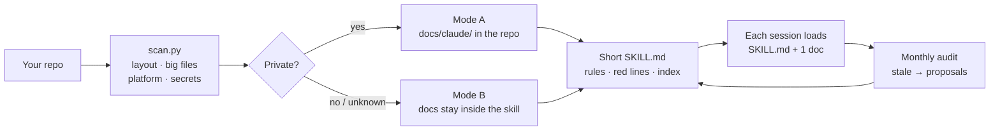

<div align="center">

# repo-skill-forge

**Give Claude a memory of your project, and stop paying for it every session.**

One request builds a lean skill for your repository: a short `SKILL.md` with your rules and red lines, feature docs that load only when needed, and a monthly audit that keeps them true.

[](LICENSE)


[What it does](#what-it-does) · [Real numbers](#real-numbers) · [Install](#install) · [Use](#use) · [Privacy](#privacy-first) · [العربية](#بالعربية)

</div>

---

## The problem

Every new chat with a coding agent starts from zero. So you either re-explain the project each time, or you keep one big instruction file that grows with every feature. The big file has three costs:

- **Tokens:** all of it loads every session, even when the task touches one corner of the project.
- **Attention:** long instruction files lower how well the model follows them.
- **Rot:** features get removed, files get renamed, and the file keeps describing things that no longer exist. The agent goes looking for them.

## What it does

Ask Claude to *"build a skill for this repo"* and repo-skill-forge:

1. **Checks the repo is private** before writing anything about it (see [Privacy](#privacy-first)).
2. **Scans it cheaply** with one script: layout, big files, very long lines, platform (deploy, database, CI), tests, folders never to open, and possible committed secrets.
3. **Asks you up to five questions:** what the project is, your red lines, plan-first or act-first, how changes ship, which features you touch most.
4. **Writes the skill in your language:**
   - a short **`SKILL.md`** (8-15 KB): start command, reading and editing rules tuned to *your* big files, coding behaviour rules, red lines, delivery, and an index;
   - **`docs/claude/*.md`**: one file per feature area (files, functions, tables, decisions), read only when a task needs it;
   - **`audit.py`**: the monthly "dreaming" pass that finds stale and missing entries.
5. **Checks its own output** for secrets and stale names, then delivers only after you approve.



It never changes your code while building the skill.

## Real numbers

Measured on the project this tool was born from: a private family photo archive (Cloudflare Workers, about 130 source files) whose hand-written skill had grown with every feature.

| | Before | After |
|---|---:|---:|
| Loaded at the start of every session | 37 KB (whole skill) | **14.6 KB** (SKILL.md) |
| Typical session (one feature) | 37 KB | **~17-21 KB** (SKILL.md + one doc) * |
| Errors found by the first review | 6 unnoticed (3 stale, 1 duplicate, 2 missing) | 0 |

\* Estimated from file sizes; a task touching every area would load slightly more than before. One project is not a benchmark: run the audit and measure on yours.

## What's inside every generated skill

- **Token-first reading rules:** one shell call to start, ranged reads only, cut long lines, never open vendor/lock/binary files, batch everything.
- **Coding behaviour rules** adapted from two well-known MIT-licensed works:
  - [**Ponytail**](https://github.com/DietrichGebert/ponytail): the lazy senior developer; the smallest complete change, a six-step ladder (does it need to exist? already in the repo? built in? …), never cut validation or security, `shortcut:` markers, `lite` / `ultra` levels.
  - [**Karpathy-inspired guidelines**](https://github.com/forrestchang/andrej-karpathy-skills) by Forrest Chang: think before coding, simplicity first, surgical changes (every changed line traces to the request), goal-driven plans (`1. … → verify: …`).
- **Your red lines and decisions**, in your words.
- **A living map** that the same commit keeps up to date, and an audit to catch what slips.

## Install

**claude.ai / Claude apps:** download [`dist/repo-skill-forge.zip`](dist/repo-skill-forge.zip) and upload it in Claude's skills settings. Code execution must be enabled.

**Claude Code (plugin, gets updates):** inside a session run
```
/plugin marketplace add 7ji0/repo-skill-forge
/plugin install repo-skill-forge@repo-skill-forge
```
On Claude Code 2.1.275 or later, one line does both: `/plugin install repo-skill-forge --marketplace 7ji0/repo-skill-forge`

**Claude Code (plain copy):**
```bash
git clone --depth 1 https://github.com/7ji0/repo-skill-forge /tmp/rsf
cp -r /tmp/rsf/skills/repo-skill-forge ~/.claude/skills/
```

**With the open `skills` CLI** (Claude Code, Cursor, Codex and other agents): `npx skills add 7ji0/repo-skill-forge`

**Other agents that read the Agent Skills format:** copy `skills/repo-skill-forge/` into their skills folder.

## Use

| Say | You get |
|---|---|
| `Build a skill for my repo owner/name` | scan → five questions → SKILL.md + docs + audit, delivered after your OK |
| `Slim down my skill for owner/name` | your existing long skill audited, then split into a short SKILL.md + docs |
| `Audit the skill` (inside the repo's sessions) | a list of stale and missing entries with evidence; nothing changes until you approve |

Then work as usual. Each session reads SKILL.md, opens only the doc for the feature you're touching, and updates that doc in the same commit as the code.

## Privacy first

Feature docs describe routes, tables, limits and checks. In a public repository that is a map for attackers. So:

| Repo | Mode | Where the docs live |
|---|---|---|
| Private | **A** (recommended) | `docs/claude/` in the repo, versioned with the code |
| Public, unknown, or your choice | **B** | inside the skill folder only; nothing is written to the repo |

In both modes the skill and docs are checked for keys, tokens, passwords and connection strings before delivery, and committed secrets found by the scan are reported (location only) so you can rotate them.

## FAQ

**Will it touch my code?** No. It writes docs and the skill; in Mode A it commits only `docs/claude/`, after you approve.

**Does it really save tokens?** It moves detail out of the always-loaded file, so most sessions load less. How much depends on your project; the table above is one real case, not a promise.

**What languages?** The skill is written in the language you talk to Claude in. Templates ship in English and Arabic.

**Which platforms?** Any. The scan detects Cloudflare, Vercel, Netlify, Docker, Node, Python, Go, Rust and more, and asks when it can't tell.

**Is this an official Anthropic project?** No. It is an independent community project.

## Credits and inspiration

- Behaviour rules adapted from [Ponytail](https://github.com/DietrichGebert/ponytail) and [andrej-karpathy-skills](https://github.com/forrestchang/andrej-karpathy-skills), both MIT. Full notices: [THIRD_PARTY_NOTICES.md](THIRD_PARTY_NOTICES.md).
- The design (small always-loaded layer, progressive disclosure, periodic "dreaming" audit) was inspired by a talk on context engineering, memory and dreaming by Lamis of Anthropic's Applied AI team at AI DevCon, and by Anthropic's posts [Effective context engineering for AI agents](https://www.anthropic.com/engineering/effective-context-engineering-for-ai-agents) and [The components of agent memory](https://www.anthropic.com/engineering/components-of-agent-memory). Not affiliated with or endorsed by Anthropic.

Made by [@7ji0](https://github.com/7ji0). MIT licensed: see [LICENSE](LICENSE).

---

<div dir="rtl">

## بالعربية

**امنح Claude ذاكرة لمشروعك، دون أن تدفع ثمنها في كل جلسة.**

كل محادثة جديدة مع وكيل البرمجة تبدأ من الصفر. فإما أن تعيد شرح مشروعك كل مرة، أو تحتفظ بملف تعليمات واحد يكبر مع كل ميزة، فيُحمَّل كاملًا في كل جلسة، ويضعف التزام النموذج به، وتبقى فيه أشياء حُذفت من الكود منذ زمن.

**ماذا تفعل المهارة؟** اطلب من Claude «اصنع مهارة لمستودعي» فتقوم بالآتي:
١. تتأكد أن المستودع **خاص** قبل أن تكتب عنه شيئًا.
٢. تفحصه بسكربت واحد قليل التكلفة: البنية، والملفات الكبيرة، والأسطر الطويلة، والمنصة، والأسرار المرفوعة بالخطأ.
٣. تسألك خمسة أسئلة على الأكثر: ما المشروع؟ ما خطوطك الحمراء؟ هل تريد خطة قبل كل تعديل؟ كيف يُنشر التعديل؟ ما الميزات التي تعمل عليها أكثر؟
٤. تكتب لك بلغتك: ملف `SKILL.md` قصيرًا فيه قواعدك وخطوطك الحمراء وفهرس، وملفات مرجعية في `docs/claude/` لكل جزء من المشروع لا تُقرأ إلا عند الحاجة، وسكربت مراجعة شهرية يكشف ما صار قديمًا.
٥. تفحص ما كتبته من الأسرار والأسماء البائتة، ولا تسلّم شيئًا قبل موافقتك.

**أرقام حقيقية من مشروع واحد:** في أرشيف صور عائلي على Cloudflare Workers، نزل ما يُحمَّل في بداية كل جلسة من ٣٧ كيلوبايت إلى ١٤٫٦، والجلسة المعتادة إلى نحو ١٧–٢١ كيلوبايت (تقدير)، وكشفت أول مراجعة ستة أخطاء لم ينتبه لها أحد: ثلاثة أشياء حُذفت من الكود وبقيت في المهارة، وتكرار، وميزتان غائبتان.

**بداخلها:** قواعد قراءة تقلل التوكنز، وقواعد سلوك برمجي مقتبسة من **Ponytail** ومن **إرشادات مستوحاة من Karpathy** (كلتاهما برخصة MIT)، وخطوطك الحمراء بكلماتك.

**الخصوصية أولًا:** في المستودع الخاص تُحفظ المراجع داخله مع الكود. وفي المستودع العام لا يُكتب فيه شيء إطلاقًا، وتبقى المراجع داخل المهارة نفسها.

**مصدر الإلهام:** محاضرة لميس من فريق الذكاء الاصطناعي التطبيقي في Anthropic عن هندسة السياق والذاكرة و«الحلم»، ومقالات Anthropic المذكورة أعلاه. المشروع مستقل وغير تابع لـ Anthropic.

</div>
